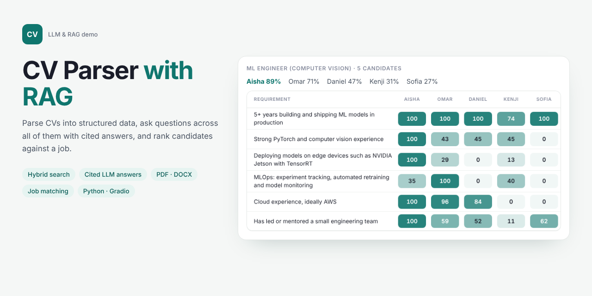
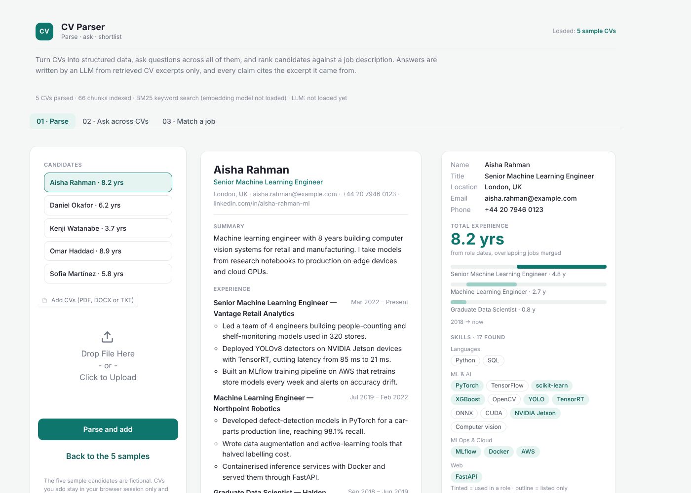
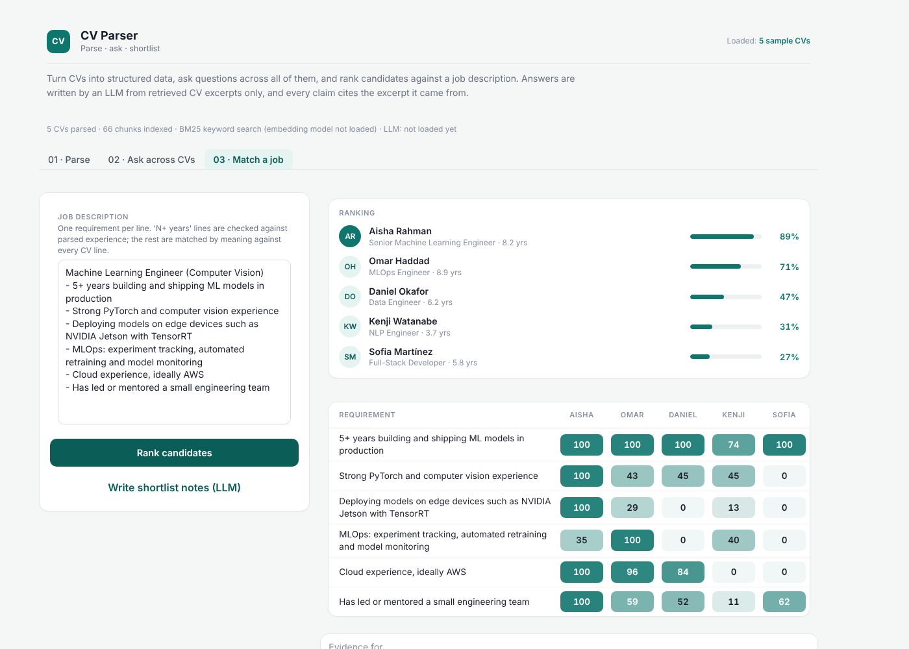

# CV Parser with RAG

Turn CVs into structured data, ask questions across all of them, and rank candidates against a job description. Answers are written by an LLM from retrieved CV excerpts only, and every claim cites the excerpt it came from, so a recruiter can check it in one click.

**Try it:** [browser version on GitHub Pages](https://hamzaasyf.github.io/cv-parser-rag/) (parsing, search and job matching, no LLM), or [run the full app locally](#run-locally) in a few minutes.



## Features

- **Parse PDF, DOCX and TXT CVs** into contact details, roles with dates, total experience (overlapping jobs merged), skills tagged as used in a role or only listed, education, certifications and languages. Download each as JSON.
- **Ask across all CVs:** "Who has built a RAG system with a vector database?" or "Compare the two strongest candidates for an MLOps role". The answer cites numbered excerpts like [2], and the cited lines are highlighted in the CV.
- **Match a job:** paste a job description and get a ranked shortlist plus a requirement-by-candidate grid. "5+ years" lines are checked against parsed experience, the rest are matched against every CV line. An LLM can then write shortlist notes with strengths and gaps.
- **Free or bring your own key:** a free open model (Qwen3 4B Instruct) runs on the Space's GPU, or paste an OpenAI or Anthropic key for stronger answers. There's also a search-only mode with no LLM.
- **Fair by design:** the model is told to judge only skills and experience and never comment on age, gender, nationality or other personal traits.





## How it works

```
CV (PDF/DOCX/TXT) ─▶ parse ─▶ chunks with role + company ─▶ embeddings + BM25 index
                                                                    │
question / job ──────────────────────────▶ hybrid search ─▶ top excerpts, numbered
                                                                    │
                                    LLM (open model or your key) ◀──┘ ─▶ answer with [n] citations
```

1. **Parse:** sections, roles and date ranges are extracted with rules, and about 60 skills are matched against a taxonomy with aliases (k8s → Kubernetes, YOLOv8 → YOLO).
2. **Chunk:** every bullet keeps its role and company, so "Deployed YOLOv8 detectors…" still knows it happened at Vantage Retail Analytics.
3. **Retrieve:** questions are embedded with bge-small-en-v1.5 and compared with every chunk, blended with BM25 keyword scores so exact terms like "TensorRT" still count.
4. **Answer:** the best excerpts (at most four per candidate) are numbered and sent to the LLM with a candidate overview. The model must cite them and say so when the CVs don't answer the question.

## Run locally

```bash
git clone https://github.com/hamzaasyf/cv-parser-rag.git
cd cv-parser-rag
./setup.sh          # creates .venv and installs requirements
./run.sh            # opens http://127.0.0.1:7860
```

The embedding model (130 MB) downloads on first start. The open LLM (about 8 GB) downloads the first time you ask with it, and runs on an NVIDIA GPU or Apple silicon. Without either, the app starts in search-only mode, and you can still use your own API key. For a lighter local model:

```bash
OPEN_MODEL=Qwen/Qwen2.5-1.5B-Instruct ./run.sh
```

## Check your setup

```bash
.venv/bin/python check.py --download
```

This checks every package, downloads any missing model, and runs a short end-to-end test: it parses the sample CVs, runs a few searches and a job match, and has the open model answer one question with citations. Add `--skip-llm` on a machine without a GPU or Apple silicon.

## Project structure

```
cv-parser-rag/
├── app.py           Gradio interface: Parse, Ask, Match a job
├── check.py         Setup check: packages, models, end-to-end test
├── ui.py            Theme (light workspace, teal), CSS and HTML components
├── src/
│   ├── parse.py     PDF/DOCX/TXT loading, sections, roles, dates, skills taxonomy
│   ├── index.py     Chunking, BM25, embeddings, hybrid search, job matching
│   └── llm.py       Prompts, citations, open model, OpenAI/Anthropic streaming
├── samples/         Five fictional CVs
└── docs/            Browser-only version (Transformers.js), served by GitHub Pages
```

## Browser-only version

`docs/index.html` runs the parser and hybrid search entirely in the browser with Transformers.js, with no LLM and nothing uploaded. It's served at [hamzaasyf.github.io/cv-parser-rag](https://hamzaasyf.github.io/cv-parser-rag/).

## Limitations

- The parser expects common CV layouts (headed sections, one role per heading with a date range). Heavily designed two-column PDFs may come out in the wrong order, and scanned PDFs need OCR first.
- Requirement scores are similarity scores, not a hiring decision. Use them to shortlist and check the cited evidence.
- The free open model is small, so for nuanced comparisons an API model gives better answers. If it is deployed on Hugging Face ZeroGPU, each visitor gets a limited amount of free GPU time per day, and answers fall back to search only when it runs out.

## Privacy

Uploaded CVs stay in your browser session and are not stored. If you use your own API key, the question and the selected excerpts are sent to that provider for that request only.

## About

Built by [Muhammad Hamza Asif](https://www.linkedin.com/in/hamzaasyf/), AI engineer working on LLM applications, computer vision and speech AI. Need something like this for your hiring or document workflow? [Get in touch on LinkedIn](https://www.linkedin.com/in/hamzaasyf/).

## Licence

Code: MIT. bge-small-en-v1.5: MIT. Qwen3 4B Instruct: Apache 2.0.
