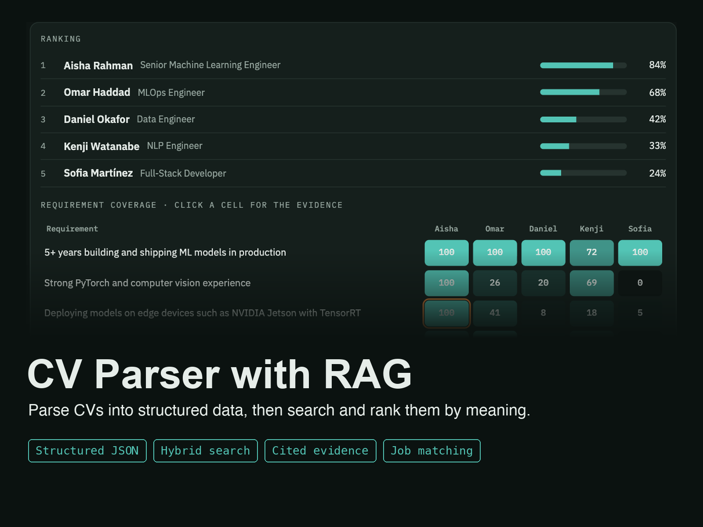
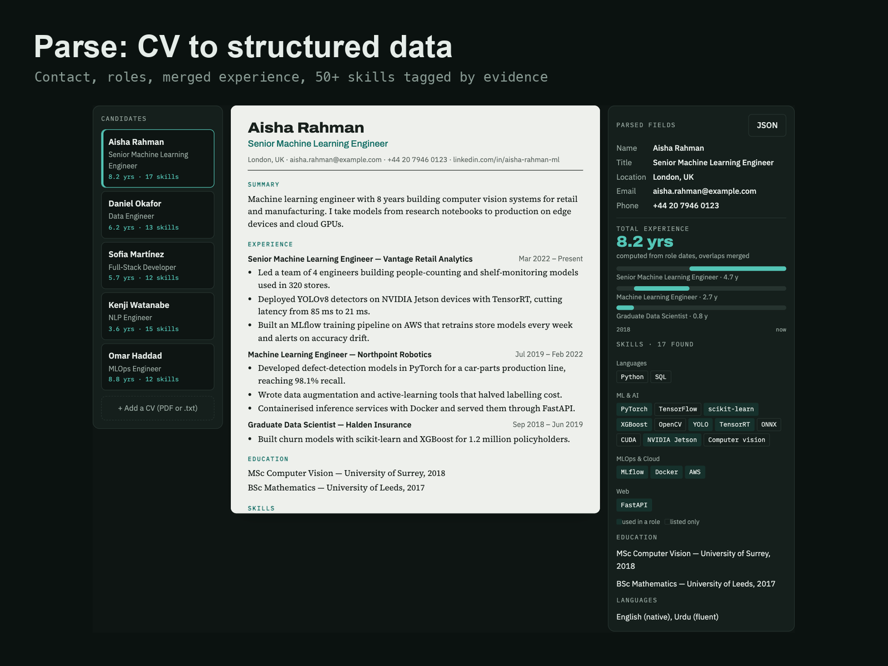
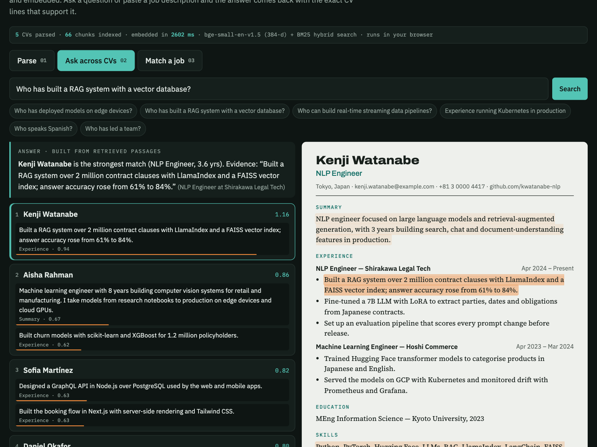

# CV Parser with RAG

Turn CVs into structured data, search across them in plain English, and rank candidates against a job description. Every answer and score points to the exact CV line behind it. Runs in your browser.

**[Try the live demo](https://hamzaasyf.github.io/cv-parser-rag/)**



## Features

- **Parse:** contact details, roles with dates, total experience (overlapping jobs merged), skills tagged by where they were used, education and languages
- **Ask across all CVs:** questions like "Who has built a RAG system with a vector database?" return the right candidate and quote the supporting line
- **Match a job:** paste a job description to get a ranked shortlist and a requirement-by-candidate coverage grid
- **Grounded answers:** click any result to see the highlighted line in the CV
- **Export:** one JSON record per candidate
- **PDF support:** CVs can be loaded as PDFs





## How it works

1. **Parse:** sections, roles and date ranges are extracted, and skills are matched against a taxonomy.
2. **Chunk:** every bullet is stored with its role and company, so it keeps its context.
3. **Retrieve:** questions are embedded with bge-small-en-v1.5 and compared with every chunk, blended with BM25 keyword scores (hybrid search).
4. **Ground:** answers and job-match scores cite the CV lines they came from.

## Run it locally

```bash
python -m http.server 8000
# then open http://localhost:8000
```

The embedding model is downloaded on first use and cached by the browser.

## Sample data

The five candidates in the demo are fictional and were written for this demo.

## Tech

- [bge-small-en-v1.5](https://huggingface.co/BAAI/bge-small-en-v1.5) embeddings via [Transformers.js](https://github.com/xenova/transformers.js)
- BM25 keyword ranking for hybrid search
- [PDF.js](https://mozilla.github.io/pdf.js/) for reading PDFs
- Plain HTML, CSS and JavaScript

## Use cases

Recruitment screening, internal talent search, and any "search our documents and show the evidence" problem.

## About

Built by [Muhammad Hamza Asif](https://www.linkedin.com/in/hamzaasyf/), AI engineer working on LLM applications, speech AI and computer vision. Need document search or RAG for your product? [Get in touch on LinkedIn](https://www.linkedin.com/in/hamzaasyf/).

## Licence

Code: MIT. bge-small-en-v1.5: MIT.
